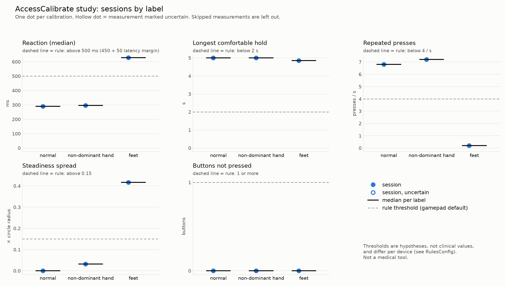

# Study results: first pilot (2026-11-19)



This is a **small pilot**: one calibration per label, three labels, recorded with study mode on 2026-11-19. It checks that the pipeline works end to end (calibration → CSV → chart) and shows the kind of differences the checks pick up. Nothing here can be generalised: each label has only one session, the file doesn't record who took part, and the thresholds are hypotheses. The CSV itself stays on the device and is not in this repository.

## Medians per label

With one session per label, each median is that session's value.

| Label | Sessions | Reaction (median) | Longest hold | Repeated presses | Steadiness spread | Buttons not reached |
|---|---|---|---|---|---|---|
| normal | 1 | 290 ms | 5.0 s | 6.8 / s | 0.000 | 0 of 4 |
| non-dominant hand | 1 | 296 ms | 5.0 s | 7.2 / s | 0.032 | 0 of 4 |
| feet | 1 | 628 ms | 4.85 s | 0.2 / s | 0.417 | 0 of 4 |

Devices: keyboard for reaction, hold, repeated presses and button reach; mouse for steadiness. All measurements were marked *ok* (none uncertain, none skipped). The current version would mark the *normal* steadiness result *uncertain* (see Observations).

**About "non-dominant hand":** the participant is ambidextrous, so this is a real result, but it isn't a "weaker hand" condition. Its values being close to *normal* is expected here and doesn't show that the checks miss a hand difference.

## What was proposed

The rules used each device's thresholds (keyboard: reaction above 450 + 50 ms, presses below 4.5 / s; mouse: spread above 0.10). The dashed lines in the chart show the gamepad defaults, not these values.

| Label | Proposed |
|---|---|
| normal | nothing |
| non-dominant hand | nothing |
| feet | timing windows ×1.5 (628 ms > 500 ms); hold instead of pressing rapidly (0.2 / s < 4.5 / s); bigger stick deadzone and medium aim assist (spread 0.417 > 0.10) |

## Observations

- **Feet vs hands.** Reaction roughly doubled (290–296 ms → 628 ms), and only one press was made in the repeated-presses window (0.2 / s). Holding a key was barely affected (4.85 s out of a 5 s maximum).
- **Steadiness with the mouse: a validity problem, now fixed.** For *normal* the spread is exactly 0.000. The hand wasn't on the mouse: the cursor sat inside the circle (mean offset 0.17 of the radius), and no movement arrived for the 5 s of measuring. It was still recorded as *ok*, i.e. as "perfectly steady", which is wrong. Two changes fix this:
  1. **Active entry.** The cursor (or the stick's dot) now has to start outside the target and be brought in by the player before measuring begins. With a mouse, the circle is placed away from wherever the cursor is, because the cursor can't be moved by code. With a stick, the resting position is outside the off-centre target. A dot that is already inside at the start has to go out and come back in.
  2. **No movement → uncertain.** If no input arrives during measuring, or the spread is practically 0 (below 0.002 of the radius), the result is *uncertain* rather than *steady*. As with any uncertain result, the related suggestion starts switched off.

  Tests cover both cases: a dot held inside from the start doesn't start measuring until it is brought in, and a parked mouse, a stick with no input, or a near-zero spread give *uncertain*.
- **Single short hold.** For *normal* the second hold lasted 0.11 s, probably a quick tap. It has no effect because the result is the longest hold (5 s).
- **Anticipation.** The first *feet* reaction trial was a press 840 ms before the signal. The first trial is always dropped, and negative values would be filtered anyway.
- **Wrong setting for the device.** For *feet* the steadiness rule proposed a *stick* deadzone, although steadiness was measured with a mouse. This has been fixed since: a mouse measurement now proposes "Smooth small mouse movements" (`mouseSmoothing`) instead.

## Reproduce

```bash
python tools/plot_study.py <path to study.csv> -o Docs/study-results.png
```

On Windows the file is at `%USERPROFILE%\AppData\LocalLow\<company>\<product>\AccessCalibrate\study\study.csv`.
