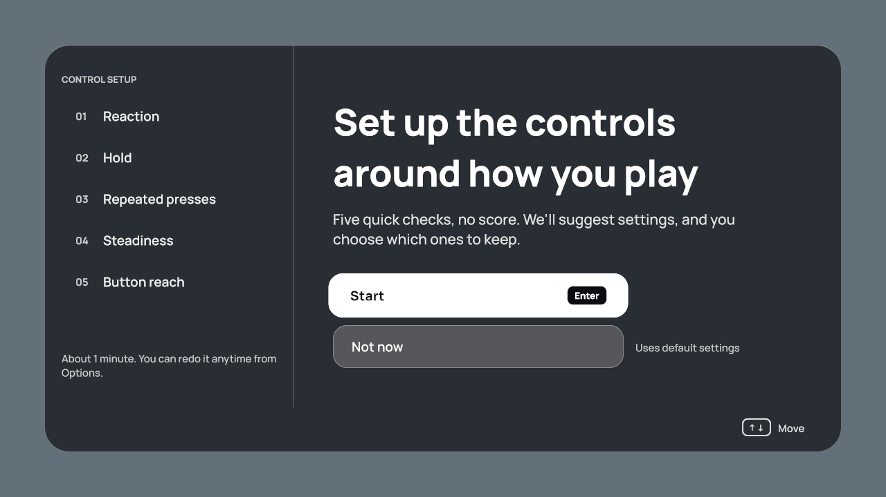
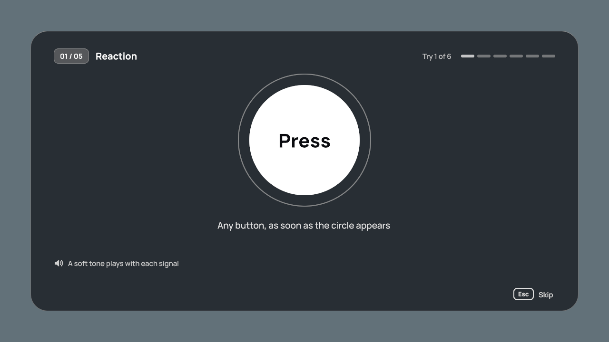
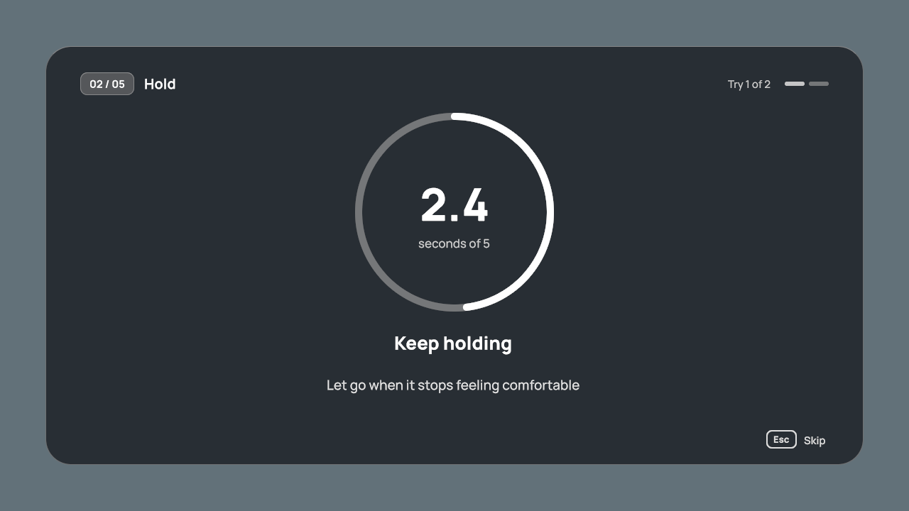
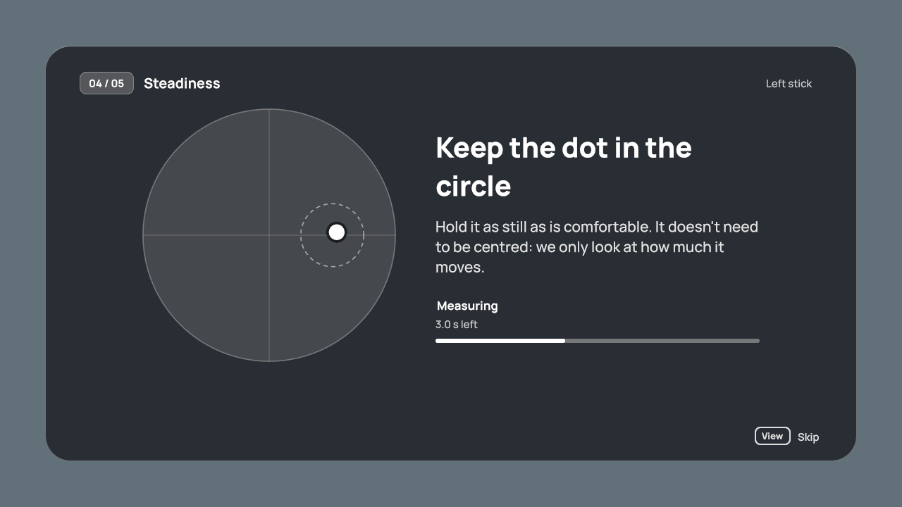
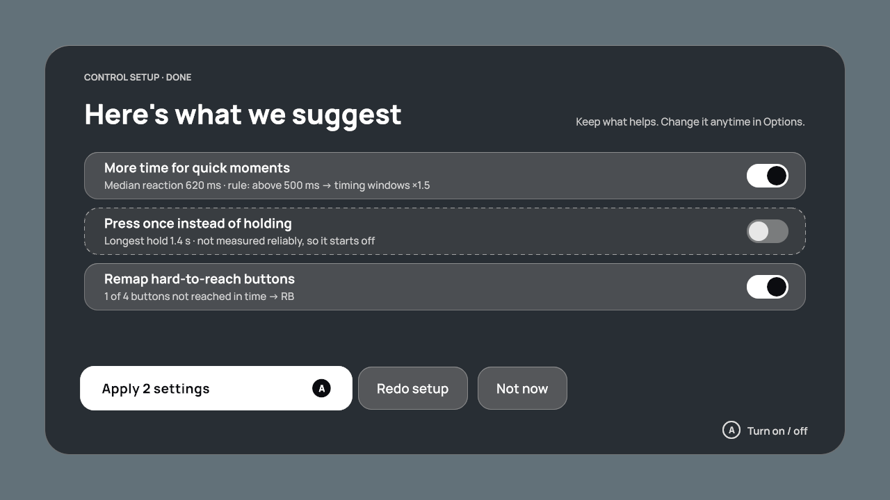
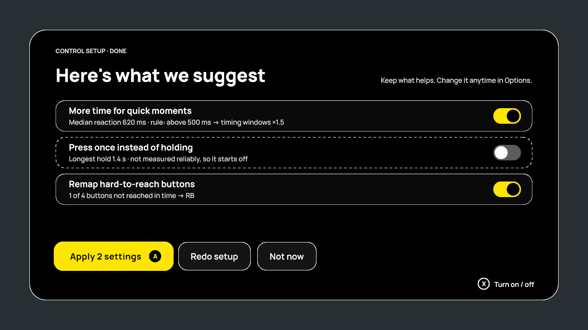
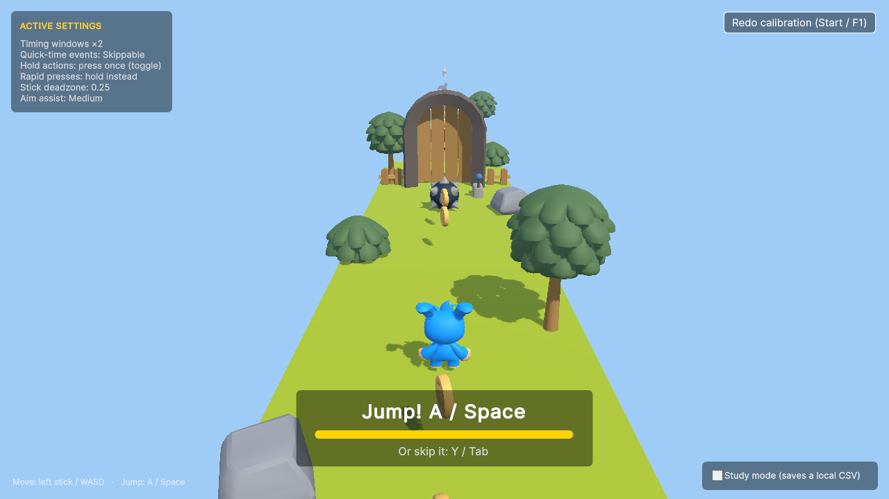
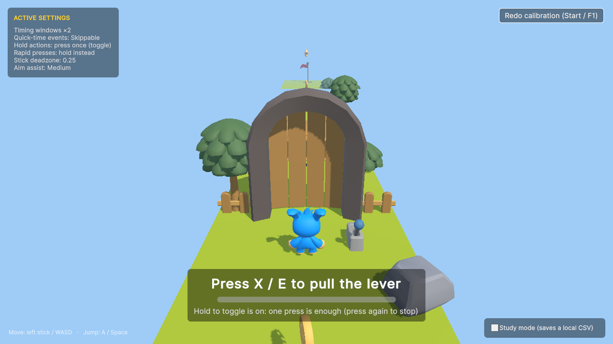

# AccessCalibrate

> **Not a medical tool.** The thresholds are hypothetical starting points and have not been clinically validated.

AccessCalibrate is an open-source Unity toolkit that applies ideas from **ability-based design** to a 60-second motor calibration with **transparent rules**. On first launch a player goes through five short checks: reaction, comfortable hold, repeated presses, steadiness and button reach. The game then suggests accessibility settings: longer timing windows, skippable quick-time events, hold-to-toggle, holding instead of mashing, a bigger stick deadzone, aim assist and button remapping. Each suggestion comes with the measurement and the rule behind it. **The player always has the final say:** every suggestion is a switch, uncertain ones start off, and nothing changes until the player presses *Apply*.

| | | |
|---|---|---|
|  |  |  |
|  |  |  |
|  |  | |

*All images are rendered by the automated tests (`BuiltInViewTests`, `DemoLevelTests`); the measurements shown are test inputs, not data from players.*

## Why

Most games already offer accessibility options: longer timing windows, toggles instead of holds, remapping. But the options sit in a menu that players have to find, understand and tune before they know which ones help. Players with motor disabilities often find out the hard way, by failing a quick-time event or a long button hold. AccessCalibrate flips the order. A one-minute calibration measures a few motor abilities, a set of plain rules turns the measurements into suggestions, and the player decides what to keep. The same measurements work on gamepad, keyboard, mouse and touch.

## How it works

```
 5 checks (~10 s each)          Measurements            RulesEngine (pure, deterministic)        Confirmation screen          Game
 reaction · hold · presses  ─►  raw trials, device,  ─►  per-device thresholds from RulesConfig ─►  one switch per suggestion ─►  AccessCalibrate.Profile
 steadiness · button reach      confidence               → ProposedChange (value + reason)         uncertain = off, Apply       OnProfileChanged
```

| Check | What is measured | Rule (gamepad defaults, all hypotheses) | Suggestion |
|---|---|---|---|
| Reaction | median of 6 trials, first dropped, < 120 ms and > 2000 ms ignored | median > 450 ms (+ 50 ms latency margin) | timing windows ×1.5 |
| | | median > 700 ms (+ 50 ms) | timing windows ×2 and skippable quick-time events |
| Hold | longest of 2 comfortable holds, max 5 s | < 2 s | press once instead of holding |
| Repeated presses | presses per second in a 5 s window from the first press | < 4 / s | hold instead of pressing rapidly |
| Steadiness | spread of the cursor around the player's own average position (2D standard deviation, × circle radius) | > 0.15 (mouse: > 0.10) | bigger stick deadzone (with a mouse: smooth small mouse movements) and medium aim assist |
| Button reach | main buttons not pressed within 5 s each (configurable) | 1 or more | remap those buttons |
| | | half or more | one-handed layout |

Keyboard, mouse and touch have their own thresholds, documented in `RulesConfig`. Every measurement is *ok*, *uncertain* (too few valid trials, even after one retry) or *skipped*. Rules never act on skipped measurements. Proposals based on uncertain measurements are shown with "not measured reliably, so it starts off".

### Design principles

- **The player decides.** Nothing is applied before *Apply*. *Not now* keeps the defaults, and every setting can be changed later from the game's options.
- **Transparent and deterministic.** The same measurements and the same `RulesConfig` always give the same suggestions, and each suggestion shows its reason ("Median reaction 620 ms · rule: above 500 ms → timing windows ×1.5").
- **No comparison with other players.** Thresholds are set by the developer. The package never derives them from other players' data, never ranks a player against a corpus, and never shows a score like "this game suits you X%".
- **No input on the player's behalf.** The package suggests settings. It never plays for the player.
- **Nobody can fail.** Wording stays neutral, any check can be skipped, the signal never flashes, the "reduce motion" option is respected, and a held button gets "Let go of the button to begin" instead of a wrong result.
- **Private.** All data stays on the device. No telemetry, no network access.

## Install

Requires Unity 6000.3 (Unity 6.3 LTS) or newer and the Input System package (1.20+). The demo also needs URP.

In Unity, open **Window → Package Manager → + → Install package from git URL…** and paste:

```
https://github.com/<user>/AccessCalibrate.git?path=/UnityProject/Packages/com.accesscalibrate
```

(Replace `<user>` with the account that hosts the repository.)

## Quick start

1. Add a `CalibrationRunner` component to a GameObject in your first scene. Optionally list your game's main buttons in its **Buttons** field, and assign a theme.
2. Then, in code:

```csharp
using AccessCalibration;

void Start()
{
    AccessCalibrate.RunIfFirstLaunch();           // Welcome → 5 checks → suggestions
    Apply(AccessCalibrate.Profile);
    AccessCalibrate.OnProfileChanged += Apply;    // after Apply, Redo, or your options menu
}

void Apply(AccessCalibration.Core.AccessibilityProfile p)
{
    qteWindow = baseWindow * p.timingMultiplier;
    holdIsToggle = p.holdToToggle;
    // p.qteMode, p.mashingMode, p.stickDeadzone, p.mouseSmoothing, p.aimAssist, p.remapSuggestions, p.suggestOneHandedLayout
}
```

`AccessCalibrate.RequestCalibration()` starts the calibration again, for example from a "Redo calibration" option. `SetProfile`, `ExportJson` and `TryImportJson` let your options menu edit, back up or move the profile.

## Architecture

```
UnityProject/Packages/com.accesscalibrate/
  Runtime/Core/      pure C# (asmdef noEngineReferences): Measurements, SignalProcessing, RulesConfig,
                     RulesEngine, ProposalReview, AccessibilityProfile (+ JSON), StudyCsv
  Runtime/Unity/     Unity adapter: CalibrationRunner, the 5 checks (Tests/), ProfileStore, AccessCalibrate (API),
                     StudyMode, CalibrationTexts, UIToolkitCalibrationView + UI/ (themes, glyphs, drawn elements)
  Runtime/UI/        UXML, USS (tokens + 3 themes), Manrope font (OFL)
  Tests/EditMode/    Core, rules, profile store, API, study CSV, theme contrast
  Tests/PlayMode/    every check with simulated input (InputTestFixture), runner, welcome, confirmation, rendering
  Samples~/Demo/     3D demo level + its tests
tools/               plot_study.py (+ tests)
Docs/                DESIGN_SPEC.md, screenshots
```

- **Core has no Unity dependency.** Its assembly is compiled with `noEngineReferences`, so the measurement and rules logic could move to another engine (e.g. Godot) unchanged.
- **Timing comes from input events.** Press and release times come from `InputAction.CallbackContext.time`. Stimuli are stamped on the same clock (`Time.realtimeSinceStartupAsDouble`). Nothing is timed from `Update()`.
- **The UI is replaceable.** The checks only talk to `ICalibrationView`. The built-in view is one implementation, and a game can supply its own.

## How it is verified

| Suite | Tests | What it covers |
|---|---|---|
| EditMode | 102 | signal processing, every rule and its edges, profile JSON, profile store (atomic writes, corrupt files), API, study CSV (culture, quoting), theme contrast ≥ 4.5:1 for all presets, no literal colours in the USS |
| PlayMode | 69 | each check with simulated keyboard / gamepad input, buttons held over from the intro, runner, welcome and confirmation flows, glyph families, rendering of every screen, the demo level (including a jump with simulated input) |
| Python | 5 | loading, grouping and medians in `tools/plot_study.py` |

A few checks were also confirmed by **breaking the code on purpose**, to make sure the tests notice:

- Reading the reaction time from the frame (`Update()`) instead of the input event makes the "signal at 0, press at 0.5 s → 500 ms" test fail (it measured 900 ms).
- Inverting the reaction rule makes 6 rule tests fail.
- Replacing the median with the mean makes 3 tests fail.

## Results

A **first pilot** (one calibration per label: *normal*, *non-dominant hand*, *feet*) is in [`Docs/study-results.md`](Docs/study-results.md), with its chart. It is too small to generalise from: one session per label, and hypothetical thresholds. It shows the pipeline working end to end and the kind of differences the checks pick up. For example, reaction 290 → 628 ms and repeated presses 6.8 → 0.2 / s from hands to feet. It also exposed a rule that proposed a *stick* deadzone after a *mouse* measurement, which is now fixed.

To run your own study, use study mode (below). It saves one CSV row per calibration with a label for the condition, and `tools/plot_study.py` compares the conditions.

## Limits

- **Not clinically validated.** All thresholds in `RulesConfig` are hypotheses chosen by the developer and documented next to each value. They are not derived from other players' data and are not compared against any reference population.
- **Display latency is unknown.** The moment a signal appears is recorded when the frame that shows it is *processed* (`Time.realtimeSinceStartupAsDouble`), not when the screen actually lights up. Rendering, the display's refresh and its internal processing add an unknown delay, which makes measured reactions slightly slower than the player really is. Reaction rules therefore only fire above *threshold + `ReactionLatencyMarginMs`* (50 ms by default), so display lag alone does not trigger them.
- **Input timing comes from input events.** Press and release times come from `InputAction.CallbackContext.time`, not from `Update()`, so frame rate does not add to the measurement. The input device's own latency (USB / Bluetooth polling) is not measured.
- **Steadiness is a spread, not a diagnosis.** The steadiness test measures how much the cursor wanders around the player's own average position (2D standard deviation, as a fraction of the circle radius). Holding still slightly off-centre is not counted as unsteadiness. The distance from the centre is stored for information only, and no rule uses it.
- **Short samples.** Each check lasts a few seconds. Fatigue, practice, the time of day, or an unfamiliar controller can change the results. That is why every suggestion stays editable, and the calibration can be repeated at any time.
- **Motor abilities only.** Vision, hearing and cognitive needs are out of scope.
- **UI Toolkit limits.** There is no real backdrop blur (the optional blur in the design spec isn't implemented, so the panel is more opaque instead). Gradients and shadows are approximated, and dashed outlines are drawn in code.

## Prior work

AccessCalibrate is **not the first** system to adapt an interface to a person's abilities. It is a small, open toolkit that applies ideas from this line of work to a 60-second motor calibration for games, with rules that the developer sets and the player can read.

- **Ability-based design.** J. O. Wobbrock, S. K. Kane, K. Z. Gajos, S. Harada, J. Froehlich, "Ability-Based Design: Concept, Principles and Examples", *ACM Transactions on Accessible Computing*, 2011. This is the framing used here: design for what a person *can* do, and let the system adapt instead of the person.
- **SUPPLE / SUPPLE++.** K. Z. Gajos, J. O. Wobbrock, D. S. Weld, "Automatically generating user interfaces adapted to users' motor and vision capabilities", *UIST 2007*; and "Improving the performance of motor-impaired users with automatically-generated, ability-based interfaces", *CHI 2008*. SUPPLE++ measures motor performance with a short set of tasks and then *generates* a whole user interface by optimisation. AccessCalibrate, by contrast, keeps the game's interface and suggests a few named settings through readable rules.
- **Detecting pointing performance.** A. Hurst, S. E. Hudson, J. Mankoff, S. Trewin, "Automatically detecting pointing performance", *IUI 2008*. Classifying pointing behaviour from interaction data, which is related to the steadiness check.
- **ABD-MT, the Ability-Based Design Mobile Toolkit.** J. Kong, M. Zhong, J. Fogarty, J. O. Wobbrock (MobileHCI 2024, *Proc. ACM HCI* 8, MHCI, article 277; [paper](https://faculty.washington.edu/wobbrock/pubs/mobilehci-24.01.pdf), [project page](https://create.uw.edu/ability-based-design-mobile-toolkit)). An Android toolkit with observers, an ability modeler and a UI adapter in which developers write adaptation rules. It is the closest in spirit (a developer toolkit with rules). AccessCalibrate targets Unity games and uses an explicit calibration instead of continuous observation.
- **Sony Interactive Entertainment patent, "User adaptation system and method"** ([US11420110B2](https://patents.google.com/patent/US11420110B2/en), [EP3808423B1](https://patents.google.com/patent/EP3808423B1/en); priority 2019). Its claims cover testing a player's controller abilities, comparing the results with reference players' playthroughs, telling the player how suitable a game is, and mitigations such as remapping or auto-input. AccessCalibrate deliberately avoids those elements. Its rules are deterministic thresholds set by the developer, it never compares a player with other players or reference data, it shows no suitability score, and it never generates input for the player. *(This is a design note, not legal advice.)*
- **ObservePlay.** An accessible gaming platform whose author describes profiling players from observation during an onboarding session instead of through settings menus ([author's post](https://dev.to/khushboo_parmar/i-built-an-accessible-gaming-platform-that-profiles-players-through-observation-instead-of-settings-3g1); a research paper was announced there, and the post's figures are self-reported).
- **Access Profiles.** "Access Profiles", *Frontiers in Computer Science*, 2026 ([article](https://www.frontiersin.org/journals/computer-science/articles/10.3389/fcomp.2026.1823366/full)). A framework for communication between game designer-developers and players with disabilities, including infrastructure to find relevant games and select settings automatically at launch. An `AccessibilityProfile` exported as JSON could fit that kind of infrastructure.

## Demo

The package includes a short 3D level, playable in 1–2 minutes, that shows what each setting does. Import it from **Package Manager → AccessCalibrate → Samples → Demo**, then open `AccessCalibrateDemo.unity`.

| Station | Setting it shows |
|---|---|
| Rolling ball: press to jump | the quick-time window is `0.8 s × timingMultiplier`; `qteMode` Skippable adds a skip button, Off jumps for you |
| Lever | `holdToToggle`: one press instead of holding for 2 s |
| Drawbridge | `mashingMode`: tap about 12 times, hold for 3 s (HoldInstead) or automatic (Auto) |
| Narrow path | `stickDeadzone` is applied to the raw stick, so small movements are ignored |

The calibration runs on the first launch. **Redo calibration** (Start / F1) is always available, and a small panel shows the active settings.

The demo needs URP with a **Universal (3D) renderer** in the pipeline asset's renderer list (it doesn't have to be the default). The demo camera selects it automatically, so a 2D project keeps its 2D renderer as the default.

3D models: [Ultimate Platformer Pack](https://quaternius.com) by Quaternius, CC0 1.0 (public domain). Only the models the demo uses are included.

## Study mode

Study mode compares sessions, for example the same person with the dominant hand, the non-dominant hand and gloves. It is off by default. Turn it on in the demo (bottom-right panel) or in code:

```csharp
StudyMode.Enabled = true;
StudyMode.Label = "non-dominant hand";
```

Each finished calibration then appends one row to a local CSV file at `Application.persistentDataPath/AccessCalibrate/study/study.csv`. A row holds the raw trials, the device and confidence of each test, the proposed profile and the label. The row is written before the player decides, so it records what was *proposed*. The data never leaves the device.

To compare one or more CSV files, run:

```bash
pip install matplotlib
python tools/plot_study.py study.csv other-device.csv -o study.png
```

The script prints a table of medians per label, then draws one small chart per measurement. Each chart shows one dot per session, a line at each label's median, and the rule threshold as a dashed line. Uncertain measurements appear as hollow dots, and skipped ones are left out. Use `--table-only` to skip the chart (then matplotlib isn't needed). To run the script's tests: `cd tools && python -m unittest test_plot_study.py`.

## Theming

The built-in screens follow the "console overlay" design in [`Docs/DESIGN_SPEC.md`](Docs/DESIGN_SPEC.md): a translucent panel over the game, a step rail, a large white focus, and controller glyphs that follow the device in use (Xbox, PlayStation, Switch, keyboard). Every colour, radius and font in the stylesheet is a `--ac-…` variable defined on `.ac-root`.

There are three presets: **Glass Dark** (default), **Glass Light** and **High Contrast** (solid black, white text, yellow focus). To use one, create a theme asset (**Assets → Create → AccessCalibrate → Theme**), pick a preset, optionally add your own USS and font, and assign it to `CalibrationRunner.Theme`. Changes show up live in Play mode. At runtime, for example when the game's own high-contrast option is on, call:

```csharp
AccessCalibrate.UseTheme(ThemePreset.HighContrast);
```

A theme USS only overrides variables, and it is applied after the default stylesheet:

```css
/* MyGameTheme.uss: warm accent, squarer corners */
.ac-root {
    --ac-focus: #FFB347;             /* primary button, current step, switches "on" */
    --ac-on-focus: #1A1206;          /* text on the accent */
    --ac-panel: rgba(28, 20, 12, 0.90);
    --ac-panel-border: rgba(255, 179, 71, 0.30);
    --ac-radius-panel: 12px;
    --ac-radius-control: 8px;
    --ac-radius-row: 6px;
}
```

| Token | Glass Dark default | Used for |
|---|---|---|
| `--ac-overlay` | `rgba(8, 10, 14, 0.55)` | full-screen dim over the game |
| `--ac-panel` | `rgba(20, 22, 30, 0.88)` | main panel |
| `--ac-panel-border` / `--ac-panel-highlight` | white 14% / 22% | panel hairline / top-edge highlight |
| `--ac-divider` | white 10% | rail divider |
| `--ac-glass-border` / `--ac-glass-highlight` | white 16% / 20% | glass controls: border / top edge |
| `--ac-text` | `#FFFFFF` | titles, labels |
| `--ac-text-secondary` | white 78% | body text |
| `--ac-text-muted` | white 62% | eyebrows, counters, notes |
| `--ac-text-hint` / `--ac-text-reason` | white 72% / 68% | hint bar / reason lines |
| `--ac-surface` / `--ac-surface-row` | white 7% / 5% | secondary buttons, chips / setting rows |
| `--ac-surface-focus` / `--ac-focus-border` | white 10% / 55% | focused row background / border |
| `--ac-focus` / `--ac-on-focus` | `#FFFFFF` / `#0B0C10` | primary button, current step, switch on, signal / text on it |
| `--ac-track` | white 16% | progress tracks, switch off |
| `--ac-uncertain-border` | white 34% | dashed outline of an uncertain row |
| `--ac-radius-panel` / `-control` / `-row` | `36px` / `20px` / `16px` | corners |
| `--ac-font-500` … `--ac-font-800` | Manrope Medium … ExtraBold | text weights |

A test checks that every preset keeps text at **4.5:1 contrast or more** over a black, a white and a grey game behind the panel. Another test checks that the stylesheet uses no colour that isn't a token.

Font: [Manrope](https://github.com/googlefonts/manrope), under the SIL Open Font License 1.1 (see `NOTICE` and `Fonts/OFL.txt`). A theme's `font` field replaces it everywhere.

## Translating the texts

Every text the player sees lives in `CalibrationTexts` (static strings). To translate it, assign your own values once at startup, before the calibration runs:

```csharp
CalibrationTexts.ReactionTitle = "Reacción";
CalibrationTexts.ButtonJump    = "Saltar (A / Espacio)";
```

Keep the `{0}` / `{1}` placeholders. If you pass your own buttons to `CalibrationRunner.Buttons`, give them already-translated names.

## Privacy

All data stays on the device. No telemetry, no network access.

## License and credits

Apache License 2.0 (see `LICENSE` and `NOTICE`). © 2026 Morozan Iulia.

- Font: Manrope, SIL Open Font License 1.1.
- Demo models: Quaternius, *Ultimate Platformer Pack*, CC0 1.0.
